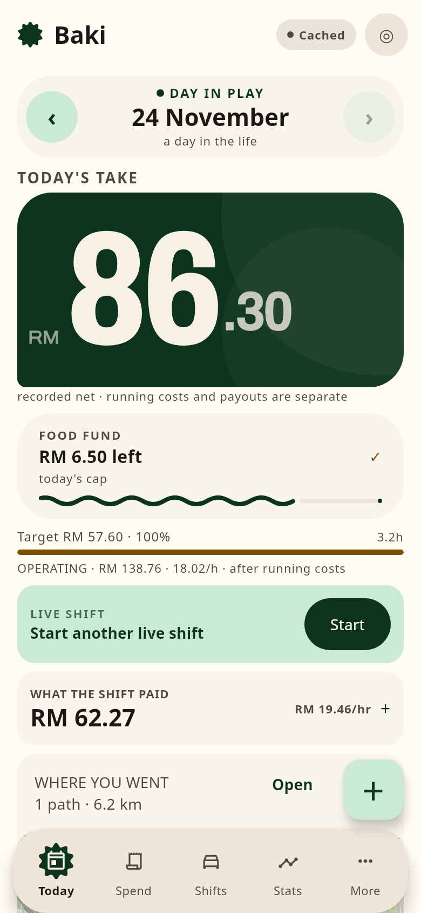
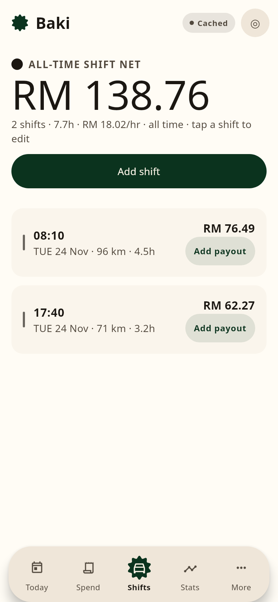
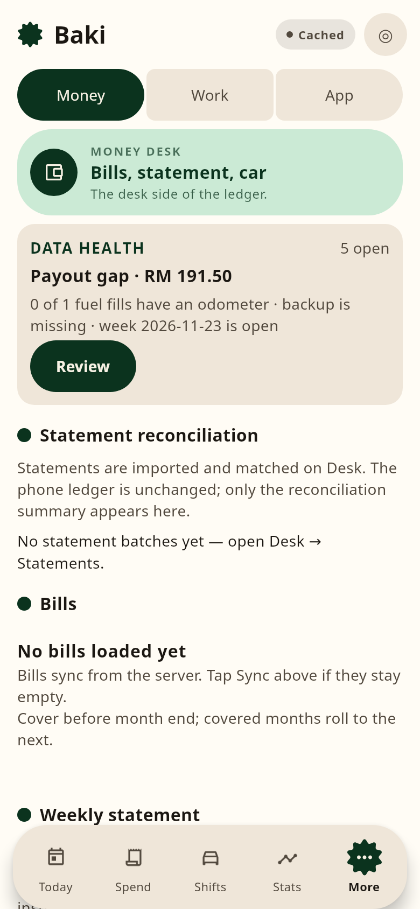
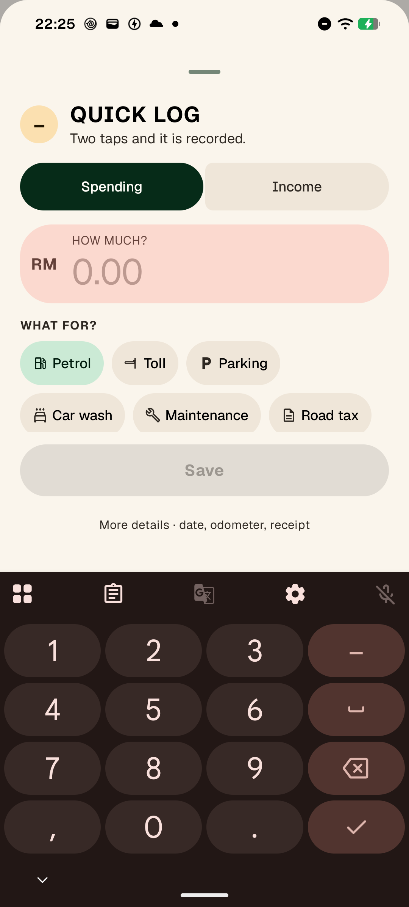
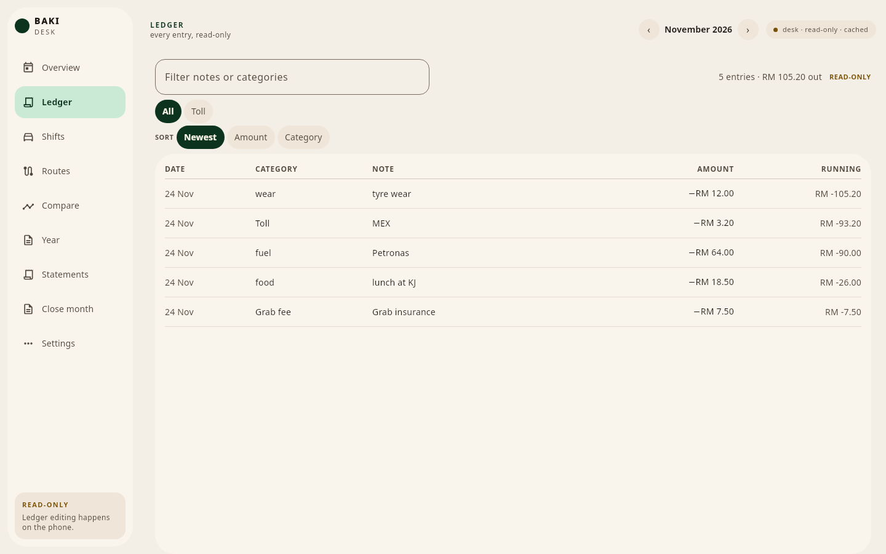

# Baki

A shift logbook for Grab drivers in Malaysia: what a shift actually pays after fuel, wear and the daily
insurance — plus weekly statement reconciliation and bills.

Two surfaces, one ledger:

| | Phone (Android) | Desktop (JVM) |
|---|---|---|
| Role | capture and decide in the moment | review, compare, print |
| Design | Material 3 Expressive · Roast & Pine | Read-only companion, same warm visual language |
| Writes | yes | no — read-only by design |

Current version: **0.64.6** (`versionCode` 265+). Material Design 3. The phone carries the working ledger; the desk reads the
same store through the sync server.

Test suite: **243 JVM tests** (`:composeApp:desktopTest`).

## Screens

<p align="center">
  
  
  
</p>
<p align="center"><sub>Today · Shifts · More and Data Health</sub></p>

<p align="center">
  
</p>
<p align="center"><sub>Quick capture · amount first, category prefilled, keypad already open</sub></p>

<p align="center">
  
</p>
<p align="center"><sub>Read-only desktop Ledger · same encrypted ledger as the phone</sub></p>

## What it does

**Shift economics**
- live shift with foreground GPS distance, pause/break, payouts, insurance cover countdown
- live yield so far: net RM/h and gross RM/km against the target
- net per shift after fuel, wear and real expenses; rate against a target RM/h
- odometer-based measured economy (km/L) when fills include readings
- odometer-anchored wear: work wear per shift, personal wear only from covered odometer intervals
- Grab insurance is shift-generated only: one fee per rolling 24h window, excluded from Quick Add

**Money**
- entries in and out, categories, search, day/month totals, budgets, funds (fuel/wear accrual)
- optional daily food cap with a compact Today line
- recurring bills tracked by **period**: settle next month before it ends, prepay ahead, link an existing
  expense, unlink without touching the ledger, optional leftovers goals (car loan)

**Income proof**
- import the weekly Grab statement PDF (Bahasa Malaysia or English labels): week, income, deductions,
  fare breakdown, insurance count, consistency check
- bulk import and share a PDF straight into the app
- reconcile statement income and insurance count against what was logged
- per-shift payout reconciliation: recorded vs received vs still due, with visible Add payout/Edit actions
- statement-funded payout allocation: split a real weekly payout across unpaid shifts, exact cents, labelled **allocated** rather than observed cash
- portable backup with last-backup health, merge-only restore confirmation, merge-conflict reporting, and optional passphrase encryption
- odometer-anchored vehicle wear on phone and Desk

**Desk extras**
- read-only tables, route traces (sealed end-to-end), month comparison, year at a glance, statement preview
- routes never leave the phone unsealed; the server stores ciphertext only

**Weekly GSF and incentives**
- Net GSF is stored as informational metadata, never subtracted from earnings a second time
- Net GSF rate and delivery incentives are kept with the weekly statement
- incentives, tips and delivery incentives are editable in the Week Close breakdown
- the PDF weekly payout remains the authoritative paid amount; Grab app screenshots cover fields the PDF does not contain

**Storage and recovery**
- normalized, encrypted SQLite is authoritative on Android and desktop; schema version 4
- SQLCipher on Android and SQLite3MultipleCiphers on desktop
- one persistent encrypted handle and diff-only row writes; entry saves stay off the UI dispatcher
- JSON snapshot retained for import/rollback; portable JSON backup remains the off-device copy
- a verified local recovery snapshot is written after every successful Week Close
- first launch after an upgrade writes one automatically if none exists; More also has **Save local recovery snapshot**
- if SQLite cannot load, the app shows an explicit **storage recovery mode** banner instead of silently presenting stale JSON

**Phone UI**
- Material 3 Expressive with the warm **Roast & Pine** palette: deep green, cream, peach and muted surfaces
- bundled **Archivo variable** type; tabular money figures and cents-first money entry
- large rounded surfaces, soft tonal cards, a floating navigation bar and a morphing add action
- hero money, live-shift card, food cap, target/operating basis and today’s entries
- responsive shift cards with time-first titles, bold amounts and payout actions
- Data Health uses a neutral warning surface with a direct 48 dp Review action
- More is split into **Money / Work / App**, with the switcher pinned above the scroll area
- cash truth, payout allocation, service target, weekly review and privacy/discreet amounts
- quick capture from app shortcuts, the live-shift notification and a 2×2 quick-log widget
- press feedback, route preview, adaptive 360–412 dp layouts and large-font support

## Stack

- Kotlin 2.4.21, Compose Multiplatform 1.12.2, AGP 9.3.1, Gradle 9.6, compileSdk 37 / minSdk 24
- Desktop runs on JDK 21
- SQLDelight 2.4.1; SQLCipher Android, SQLite3MultipleCiphers desktop
- Server: Node (`../grab-tracker/server.mjs`), JSON store, merge-only writes, tombstones, 30 rotating backups
- PDF: `pdfbox-android` on the phone, `pdfbox` on the desk
- Phone/desktop type: **Archivo variable** (SIL Open Font License 1.1), bundled with the app

## Layout

```
composeApp/src/commonMain/   model, money maths, cover rule, merge, sync, statement parser, vehicle wear, UI
composeApp/src/androidMain/  activity, live service, GPS, widget, PDF picker
composeApp/src/desktopMain/  read-only desk shell, PDF, printing, local database
../grab-tracker/             sync server + PWA (still intact)
scripts/                     release.sh, shots.sh (deterministic desk captures)
```

## Android verification

The API 36 AVD lane installs a separate `.verify` build and runs Compose instrumentation tests without touching the real ledger:

```bash
./scripts/android-avd-setup.sh   # once
./scripts/android-test.sh
./scripts/android-emulator-gui.sh   # visible emulator + signed app
```

See [ANDROID_TESTING.md](ANDROID_TESTING.md).

## Running

```bash
# fast loop: targeted test, warm daemon, no release build
./scripts/fastcheck.sh app.baki.PhoneShot

# complete gate: full JVM suite + Android lane + release build
./scripts/gate.sh

# R8 release build in a memory-capped systemd service
# close Firefox/heavy apps first; R8 failure cannot kill the desktop session
./scripts/release-r8-safe.sh

# all tests under the capped build wrapper
./scripts/gradle-capped.sh :composeApp:desktopTest

# desktop app
./scripts/gradle-capped.sh :composeApp:run

# server (same machine or LAN)
cd ../grab-tracker && node server.mjs

# interactive phone preview: isolated 75-day synthetic ledger
BAKI_PREVIEW_SCENARIO=synthetic BAKI_PREVIEW_SEED=42 ./scripts/gradle-capped.sh :composeApp:run
# BAKI_PREVIEW_SCENARIO=real falls back to the old copied-store preview

# signed phone build -> dist/baki-compose-<version>.apk
./scripts/release.sh 0.64.6
```

Phone install: enable wireless debugging, `adb connect <phone>:<port>`, then
`adb install -r dist/baki-compose-0.64.6.apk`. The release key lives in `../.tools/keystore` and is never
committed.

## Data & sync

- One store per user; the phone and desk share it through `POST/GET /api/data`.
- Writes merge by id, newest wins; deletions are tombstones; statements are keyed by week.
- Client config (server URL, theme, route key, **durable outbox bit**) is device-local.
- A local save marks the outbox; the sync loop retries it after restarts and sends tombstones with the
  full-store push, so offline edits and deletes cannot sit silently on one device.
- Local writes go to encrypted SQLite first; the generic operation outbox is the sync source of truth.
- SQLite writes use one transaction per change and a persistent SQLCipher handle.
- The local JSON snapshot is a rollback/import path, not the live store; it is not rewritten after cutover.
- A verified local recovery snapshot is created after Week Close. A failed SQLite load surfaces a
  recovery banner and never silently pretends the stale JSON is current.
- Server keeps 30 rotating backups in `../grab-tracker/backups/`.

## Docs

- [WORKFLOW.md](WORKFLOW.md) — fast loop vs release gate
- [DESIGN.md](DESIGN.md) — material doctrine, Surface depth, desktop layout, statement decisions
- [ACCESSIBILITY.md](ACCESSIBILITY.md) — enforced contrast/behaviour and current gaps
- [BUGS.md](BUGS.md) — known issues and parked work
- [STATUS.md](STATUS.md) — current release, data state and next gates
- [NEXT.md](NEXT.md) — release and design history
- [PARITY.md](PARITY.md) — PWA → Compose feature comparison
- [PERFORMANCE.md](PERFORMANCE.md) — benchmark baseline and how to rerun

## Known constraints

- The sync API is open unless `BAKI_TOKEN` is set; treat an untokened server as LAN-only.
- The desk is read-only by design.
- Dynamic (wallpaper) colour is not contrast-clamped.
- SQLite is authoritative; portable backup is still a manual, off-device action.
- Phone TalkBack coverage of custom canvases and swipe rows is incomplete.
- Cover renewal uses the saved wall-clock end (`hours + breakMinutes`). Older shifts without a
  break value fall back to worked hours.

## API token

The ledger API is open on the LAN unless the server is started with a shared token:

```bash
BAKI_TOKEN='choose-a-long-random-token' ./sync.sh
```

Enter the same token in **More → App → API token**. Without it, data, route and
live-event requests receive `401`. The token is included in portable backups, so
treat those files as private.


## Build memory

Heavy Gradle builds run in a capped cgroup so a memory spike kills the build, not the desktop:

```bash
./scripts/gradle-capped.sh :composeApp:desktopTest
./scripts/gradle-capped.sh :composeApp:assembleRelease
```

The wrapper serializes builds, caps the Gradle and Kotlin JVMs, and stops idle daemons afterwards.
Direct `./gradlew` builds still inherit the heap/worker caps in `gradle.properties`, but the 6 GB
cgroup cage only applies through the wrapper. Use `BAKI_KEEP_DAEMONS=1` if you need warm daemons.

## Visual reference rendering

For JS-heavy design references, render the real page instead of scraping its title:

```bash
./scripts/render-site.sh https://m3.material.io/styles/spacing/overview
RENDER_DARK=1 ./scripts/render-site.sh <url>
```

Outputs full-page desktop and phone screenshots under `design-reference/`.


## Interactive Phone Preview

A separate desktop window for testing the real phone shell without a phone.
Open it from **Desk → Settings → Phone Preview → Open Phone Preview**, or launch directly:

```bash
BAKI_SHELL=phone ./Baki
```

It uses an isolated copy of the ledger under `~/.baki-preview-home`; edits never reach the real store
or server. The controls window handles Auto/Light/Dark, System/Baki, high contrast, and the Motion Lab
(Expressive / Standard / Slow, plus reduced motion).

```bash
BAKI_PREVIEW_RESET=1 BAKI_SHELL=phone ./Baki   # refresh the copy from the live ledger
```

Motion can be reviewed interactively. Slow mode is a deliberately low-stiffness preview scheme;
real Android frame pacing still needs the emulator or phone.
